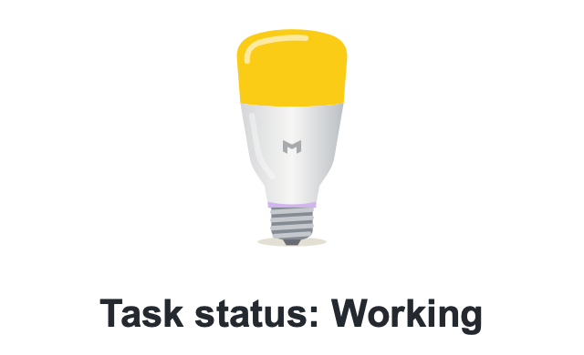
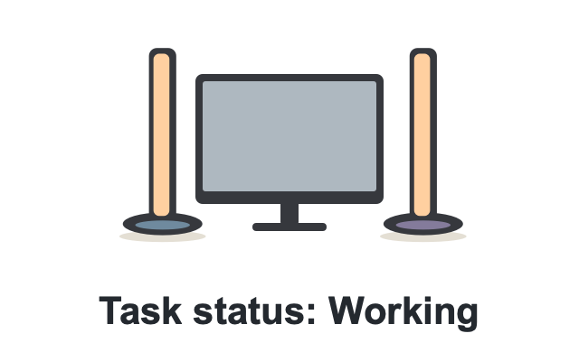
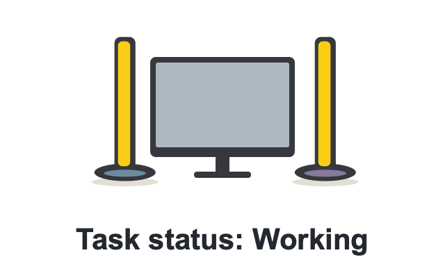
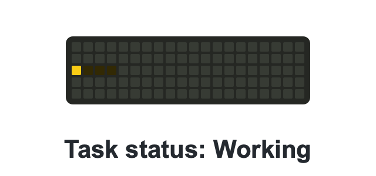
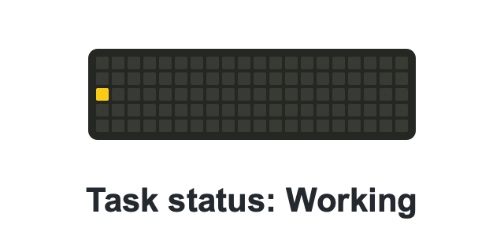
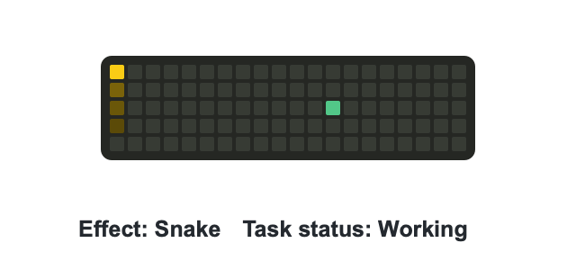
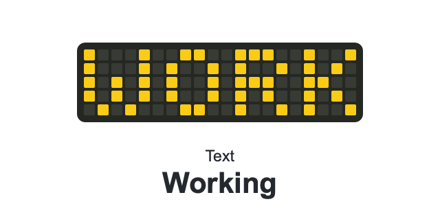
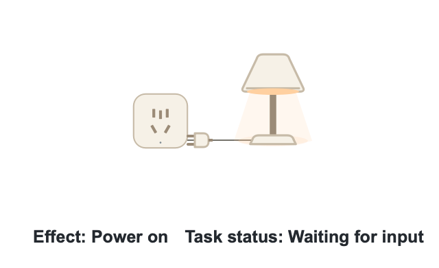
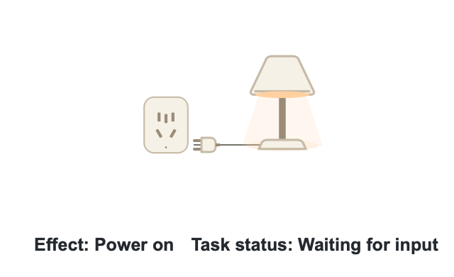

# SeeEnd

[中文](README.md) · **English** · [Download](https://github.com/YipengChen/SeeEnd/releases) · [User guide](docs/quick-start.md)

See your AI task status through a desktop flame, notifications, sounds, WeChat, or lights: working, waiting for input, and done.

**No extra hardware or model API key for SeeEnd is required.** Physical lights are optional.

## Light notifications

### Yeelight Screen Light Bar Pro

| White light | Color light |
| :---: | :---: |
| <picture><source media="(prefers-color-scheme: dark)" srcset="docs/images/light-effects/en/dark/screen-light-bar-white.webp"></picture> | <picture><source media="(prefers-color-scheme: dark)" srcset="docs/images/light-effects/en/dark/screen-light-bar-color.webp"></picture> |

### Yeelight W3 Color Bulb

| White light | Color light |
| :---: | :---: |
| <picture><source media="(prefers-color-scheme: dark)" srcset="docs/images/light-effects/en/dark/w3-bulb-white.webp"></picture> | <picture><source media="(prefers-color-scheme: dark)" srcset="docs/images/light-effects/en/dark/w3-bulb-color.webp"></picture> |

### Yeelight Beam

| White light | Color light |
| :---: | :---: |
| <picture><source media="(prefers-color-scheme: dark)" srcset="docs/images/light-effects/en/dark/beam-white.webp"></picture> | <picture><source media="(prefers-color-scheme: dark)" srcset="docs/images/light-effects/en/dark/beam-color.webp"></picture> |

### Yeelight Cube Lite pixel effects

| Pixel status | Comet |
| :---: | :---: |
| <picture><source media="(prefers-color-scheme: dark)" srcset="docs/images/light-effects/en/dark/cube-status.webp"></picture> | <picture><source media="(prefers-color-scheme: dark)" srcset="docs/images/light-effects/en/dark/cube-comet.webp"></picture> |
| **Snake** | **Text** |
| <picture><source media="(prefers-color-scheme: dark)" srcset="docs/images/light-effects/en/dark/cube-snake.webp"></picture> | <picture><source media="(prefers-color-scheme: dark)" srcset="docs/images/light-effects/en/dark/cube-text.webp"></picture> |

### Mijia Smart Plug 3

<picture><source media="(prefers-color-scheme: dark)" srcset="docs/images/light-effects/en/dark/mijia-plug-3.webp"></picture>

### Mijia Smart Plug 4

<picture><source media="(prefers-color-scheme: dark)" srcset="docs/images/light-effects/en/dark/mijia-plug-4.webp"></picture>

By default, power is off while working and on for input or completion. These rules are customizable.

These are **effect previews** using bright display settings. Physical brightness and color vary by device. See [device setup](docs/quick-start.md#连接设备). Animation playback can be enabled in [GitHub accessibility settings](https://github.com/settings/accessibility).

## Connect your AI tools

| Integration | Sources |
| --- | --- |
| Coding tools | Codex, Claude Code, Qoder CLI, DeepSeek Harness, Gemini CLI, OpenCode |
| Browser extension | ChatGPT, DeepSeek, Qianwen, Doubao, Yuanbao, Kimi, Zhipu, Claude, Gemini (experimental) |
| Local API | Your own scripts and tools |

## Get started

1. Download your platform's app from [Releases](https://github.com/YipengChen/SeeEnd/releases) and launch it.
2. Open App integrations and follow the Skill or browser extension setup.
3. Start a new task to try working, input, and completion notifications.

The developer materials ZIP is optional for app users. See the [user guide](docs/quick-start.md) for installation, permissions, and device setup.

## Documentation and contributions

[Develop and build](docs/development.en.md) · [Contribute](CONTRIBUTING.md) · [Features and compatibility](docs/product/CURRENT_PRODUCT.md) · [All docs](docs/README.md)

Original code is licensed under [GPL-3.0-only](LICENSE). Third-party components and brand assets retain their own terms. See [third-party notices](THIRD_PARTY_NOTICES.md).
