# SeeEnd

**中文** · [English](README.en.md) · [下载应用](https://github.com/YipengChen/SeeEnd/releases) · [使用指南](docs/quick-start.md)

让 AI 的任务状态（工作中、等待输入、已完成）看得见。可通过桌面火焰（虚拟）、系统通知、音效、微信通知或多种实体灯具（灯光）提醒你。

**软件不读取对话内容，不读取API Key，无云端服务。** 实体灯具是可选（建议）的提醒方式。

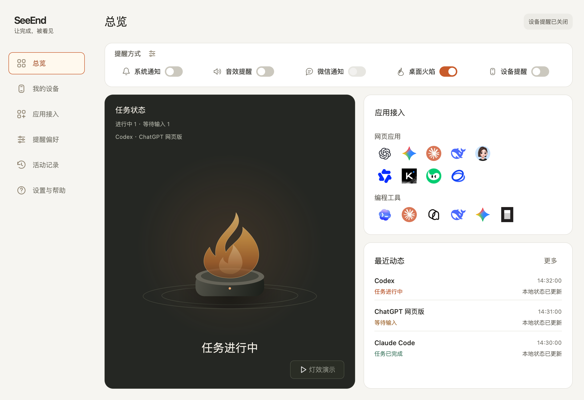

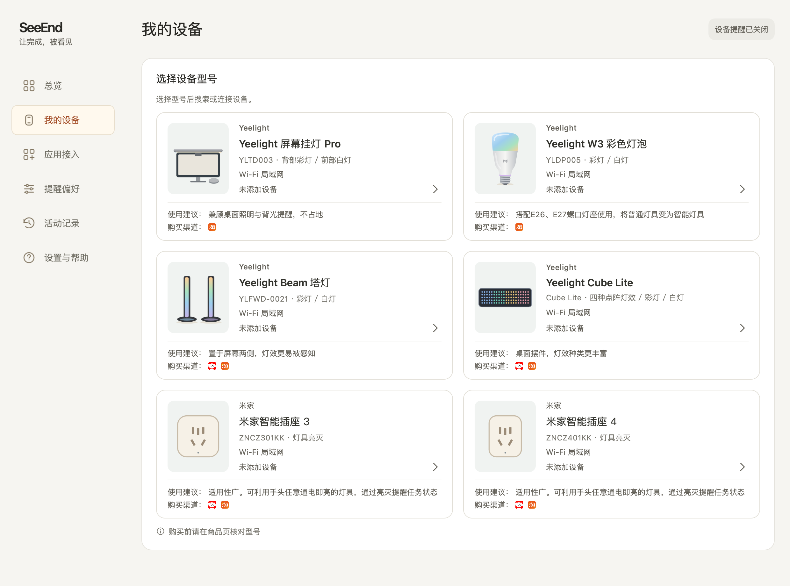

## 灯光提醒

### Yeelight 屏幕挂灯 Pro

| 白灯 | 彩灯 |
| :---: | :---: |
| <picture><source media="(prefers-color-scheme: dark)" srcset="docs/images/light-effects/zh/dark/screen-light-bar-white.webp"></picture> | <picture><source media="(prefers-color-scheme: dark)" srcset="docs/images/light-effects/zh/dark/screen-light-bar-color.webp"></picture> |

### Yeelight W3 彩色灯泡

| 白灯 | 彩灯 |
| :---: | :---: |
| <picture><source media="(prefers-color-scheme: dark)" srcset="docs/images/light-effects/zh/dark/w3-bulb-white.webp">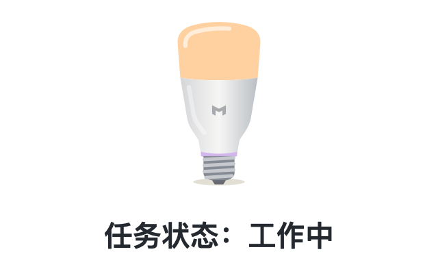</picture> | <picture><source media="(prefers-color-scheme: dark)" srcset="docs/images/light-effects/zh/dark/w3-bulb-color.webp">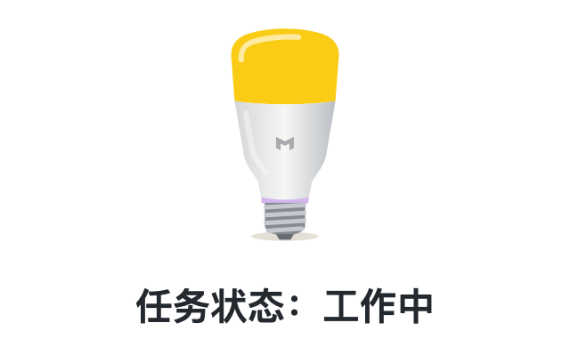</picture> |

### Yeelight Beam 塔灯

| 白灯 | 彩灯 |
| :---: | :---: |
| <picture><source media="(prefers-color-scheme: dark)" srcset="docs/images/light-effects/zh/dark/beam-white.webp">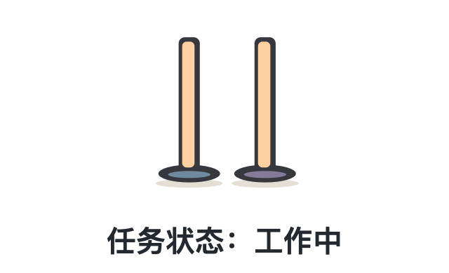</picture> | <picture><source media="(prefers-color-scheme: dark)" srcset="docs/images/light-effects/zh/dark/beam-color.webp">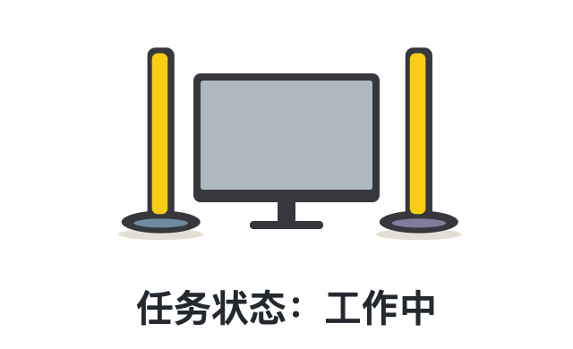</picture> |

### Yeelight Cube Lite 点阵

| 像素状态牌 | 彗星巡航 |
| :---: | :---: |
| <picture><source media="(prefers-color-scheme: dark)" srcset="docs/images/light-effects/zh/dark/cube-status.webp">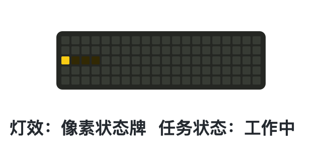</picture> | <picture><source media="(prefers-color-scheme: dark)" srcset="docs/images/light-effects/zh/dark/cube-comet.webp">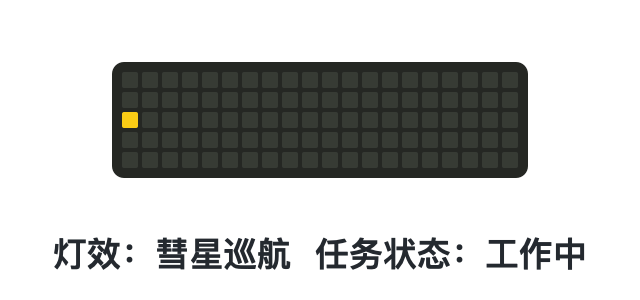</picture> |
| **贪吃蛇** | **文字状态** |
| <picture><source media="(prefers-color-scheme: dark)" srcset="docs/images/light-effects/zh/dark/cube-snake.webp">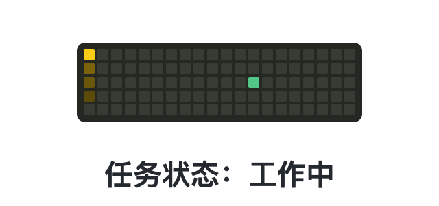</picture> | <picture><source media="(prefers-color-scheme: dark)" srcset="docs/images/light-effects/zh/dark/cube-text.webp">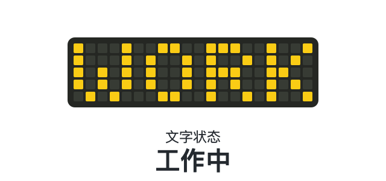</picture> |

### 米家智能插座3

| 通断电提醒 |
| :---: |
| <picture><source media="(prefers-color-scheme: dark)" srcset="docs/images/light-effects/zh/dark/mijia-plug-3.webp">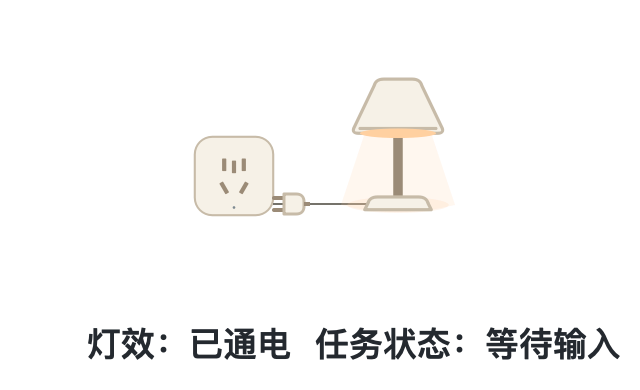</picture> |

### 米家智能插座4

| 通断电提醒 |
| :---: |
| <picture><source media="(prefers-color-scheme: dark)" srcset="docs/images/light-effects/zh/dark/mijia-plug-4.webp">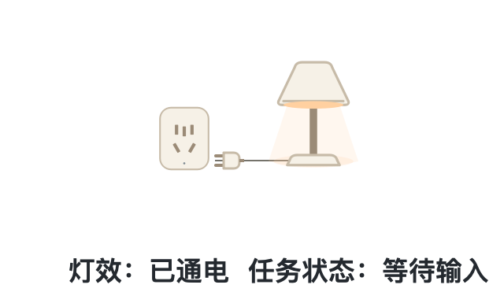</picture> |

默认工作中断电，等待输入和完成时通电；可自行设置。

以上为**灯效示意**，使用高亮参数；实际色彩与亮度以设备为准。连接步骤见[设备指南](docs/quick-start.md#连接设备)。

## 接入 AI 工具

| 方式 | 支持来源 |
| --- | --- |
| 编程工具 | Codex、Claude Code、Qoder CLI、DeepSeek Harness、Gemini CLI、OpenCode |
| 网页 | ChatGPT、DeepSeek、千问、豆包、元宝、Kimi、智谱清言、Claude、Gemini |
| 本地 API | 你自己的脚本或工具 |

## 开始使用

1. 在 [Releases](https://github.com/YipengChen/SeeEnd/releases) 下载对应系统的安装包并启动。
2. 打开「应用接入」，按引导安装 Skill 或浏览器扩展。
3. 提交一条新任务，体验开始、等待输入和完成提醒。

无需下载开发资料包即可使用应用。安装、权限与灯具连接见[使用指南](docs/quick-start.md)。

## 文档与贡献

[开发与构建](docs/development.md) · [参与贡献](CONTRIBUTING.md) · [功能与兼容范围](docs/product/CURRENT_PRODUCT.md) · [全部文档](docs/README.md)

原创代码采用 [GPL-3.0-only](LICENSE)。第三方组件和品牌素材保留各自许可，详见[第三方说明](THIRD_PARTY_NOTICES.md)。
