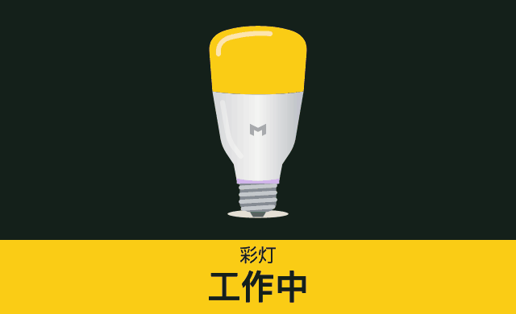
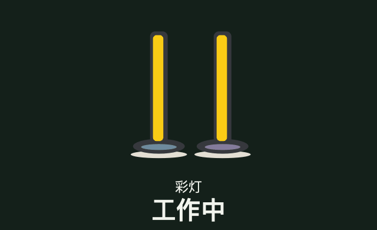
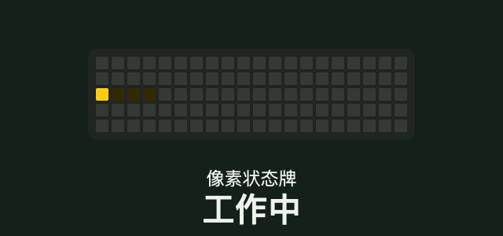
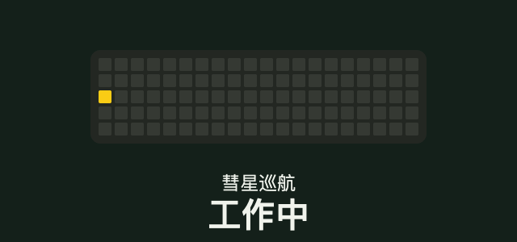
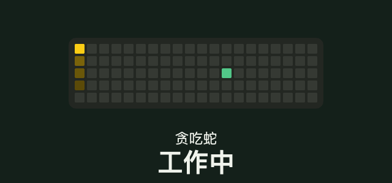
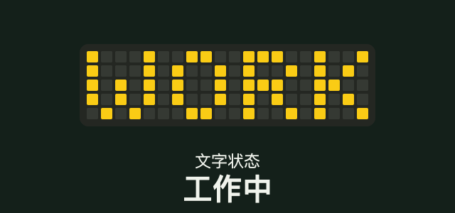
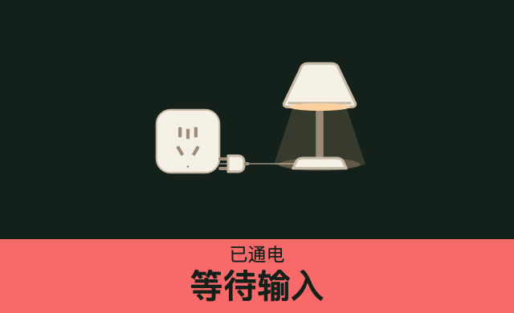
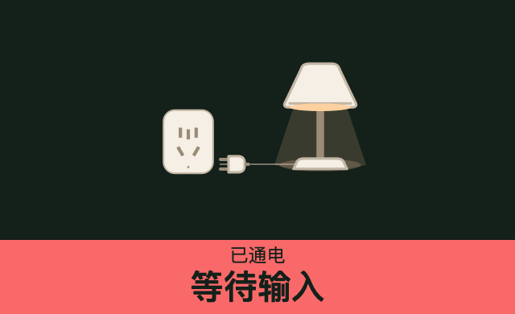

# SeeEnd

**中文** · [English](README.en.md) · [下载应用](https://github.com/YipengChen/SeeEnd/releases) · [使用指南](docs/quick-start.md)

让 AI 的任务状态看得见：工作中、等待输入、已完成，通过桌面火焰、通知、音效、微信或灯光提醒你。

**无需额外硬件，无需向 SeeEnd 提供模型 API Key。** 实体灯具是可选的提醒方式。

## 灯光提醒

屏幕挂灯、W3 彩色灯泡和 Beam 塔灯，支持彩灯与白灯两种提醒方式。

| 屏幕挂灯 Pro | W3 彩色灯泡 | Beam 塔灯 |
| :---: | :---: | :---: |
|  |  |  |

默认彩灯：**黄色工作中 · 红色等待输入 · 绿色已完成**，颜色和亮度可以自行设置。

### Cube Lite 点阵

| 像素状态牌 | 彗星巡航 |
| :---: | :---: |
|  |  |
| **贪吃蛇** | **文字状态** |
|  |  |

### 米家智能插座

| 插座 3 · ZNCZ301KK | 插座 4 · ZNCZ401KK |
| :---: | :---: |
|  |  |

默认工作中断电，等待输入和完成时通电；可自行设置。

以上为**灯效示意**，使用高亮参数；实际色彩与亮度以设备为准。连接步骤见[设备指南](docs/quick-start.md#连接设备)。GIF 自动播放可在 [GitHub 辅助功能设置](https://github.com/settings/accessibility)中开启。

## 接入 AI 工具

| 方式 | 支持来源 |
| --- | --- |
| 编程工具 | Codex、Claude Code、Qoder CLI、DeepSeek Harness、Gemini CLI、OpenCode |
| 浏览器扩展 | ChatGPT、DeepSeek、千问、豆包、元宝、Kimi、智谱清言、Claude、Gemini（实验功能） |
| 本地 API | 你自己的脚本或工具 |

## 开始使用

1. 在 [Releases](https://github.com/YipengChen/SeeEnd/releases) 下载对应系统的安装包并启动。
2. 打开「应用接入」，按引导安装 Skill 或浏览器扩展。
3. 提交一条新任务，体验开始、等待输入和完成提醒。

无需下载开发资料包即可使用应用。安装、权限与灯具连接见[使用指南](docs/quick-start.md)。

## 文档与贡献

[开发与构建](docs/development.md) · [参与贡献](CONTRIBUTING.md) · [功能与兼容范围](docs/product/CURRENT_PRODUCT.md) · [全部文档](docs/README.md)

原创代码采用 [GPL-3.0-only](LICENSE)。第三方组件和品牌素材保留各自许可，详见[第三方说明](THIRD_PARTY_NOTICES.md)。
