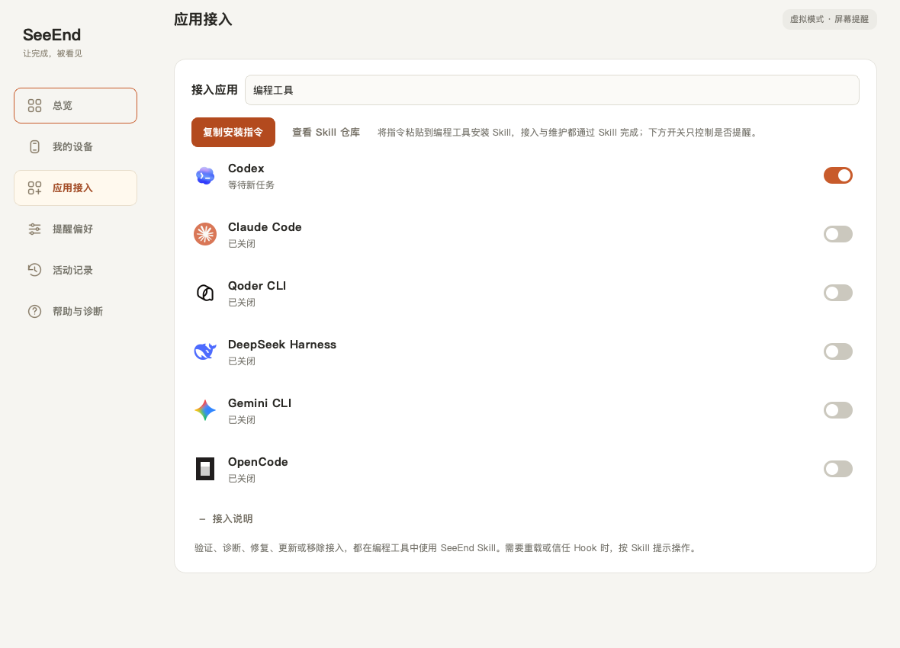

# SeeEnd 桌面预览版使用

当前版本支持 Yeelight YLTD003 与 YLDP005 两款局域网灯具，以及无需灯具的虚拟模式。沿用旧版数据目录，已有 Yeelight 设置保留；AI Flame 0.1 / 0.2 记录不再加载。用 SeeEnd.app 替换旧 App 后，在「应用接入」使用 SeeEnd Skill 为编程工具更新接入，并按工具提示加载配置；网页扩展通过「安装浏览器扩展」引导更新。这样会更新指向旧 App 的接入路径。

## 打开 App

最新 App 统一位于 `dist/SeeEnd.app`，构建脚本也默认输出到此处。先退出运行中的旧版，再双击新版启动；提醒颜色与各状态亮度在「我的设备 → 对应设备 → 灯光表现」中调节，每台设备独立保存，离线也可修改；原有设置会自动迁移。App 内置 Hub，无需另开启动脚本。桌面使用六页原生界面，不启动 QtWebEngineProcess；隐藏到托盘后停止界面刷新，Hub 继续工作。真实客户端与实体灯光的验收范围见历史记录，不以模拟测试代替实机结果。

关闭窗口时保留菜单栏／托盘后台运行；macOS 保留 Dock 图标，可通过 Dock 或菜单「打开 SeeEnd」恢复原窗口。重复启动会唤起已有窗口，同一用户只运行一个桌面实例。窗口恢复会保留当前页面和尺寸，不会永久置顶。菜单「退出 SeeEnd」停止本 App 启动的 Hub；没有托盘的平台关闭最后窗口即退出。若 App 连接的是独立的无界面 Hub，退出 App 不会停止该独立服务。各入口的验收范围见验收记录。

开发时可使用 `python app.py` 或 `python app.py --hub`；不要同时启动两份 Hub。

## 选择运行模式

总览顶部可切换「虚拟模式」与「硬件模式」，选择立即保存，重启后保持。首次使用和未保存模式的旧版升级默认虚拟烛火；原配对信息、应用接入和提醒偏好保留。

- **虚拟模式**：使用屏幕烛火和菜单栏提醒，不发现局域网灯具，也不自动重连。设备页提供返回总览切换模式的入口。
- **硬件模式**：尝试恢复已配对设备连接，未配对时可到「我的设备」连接。所有页面顶部持续显示未连接提醒，连接成功后自动消失；暂停、静默或关闭窗口到托盘仍保留未连接状态提示。

切回虚拟模式会立即保存选择并停止硬件调度，在后台释放连接并尝试熄灭已连接灯具；配对信息保留。若快速切回硬件模式，会在旧连接完全关闭后自动重连。模拟诊断进行中需等待完成再切换。

总览「应用接入」下显示已开启 AI 来源的小图标，同一品牌的网页与桌面来源合并显示，悬停可查看来源，点击图标进入应用接入。最近动态右上角的「更多」进入完整活动记录。硬件模式未连接时，连接入口统一保留在顶部提示条。

## 没有火焰灯：先验证你的用法

1. 在总览点击「应用接入」，在「接入应用」中选择类型并开启实际使用的来源。「接入说明」只展示当前类型的操作方法。网页、桌面客户端和本地 API 是不同接入，不能互相替代验证。
2. 按当前类型的说明完成接入：编程工具通过 SeeEnd Skill 安装并验证；网页点击「安装浏览器扩展」并完成四步引导；macOS 桌面实验接入需开启来源并完成权限授权。未列出的工具不会自动识别，可自行通过本地 API 上报状态。
3. 按所选接入的提示，在对应 AI 应用发送一条新任务。
4. 观察总览屏幕火焰或菜单栏从「工作中」到「已完成」。屏幕实时火焰会呼吸 / 跃动，完成和异常按设定时长结束；实体灯具以常亮颜色区分任务状态。
5. 在接入列表查看来源状态，到「活动记录」查看开始、完成时间及处理结果。只有真实来源同一任务完整配对才显示「已收到同一任务的开始与完成」；取消、异常、超时与不完整事件分别提示。活动记录可导出 CSV。

验证记录仅证明本机所选来源收到了此次任务状态，不代表所有模型、模式、客户端版本或后台场景均适配。请核对提醒时机，并分别尝试平时使用的模型 / 模式、长任务、切到后台、主动中断等场景。APP 不读取或评估回答质量；网页 / 客户端变更后应重新验证。历史保留 7 天、最多 10,000 条，来源状态统计不局限于页面最近 50 条。

左下角常驻显示当前应用版本。总览左侧状态卡中的「灯效演示」持续 10 秒：前 5 秒进行中，后 5 秒已完成。虚拟模式仅在屏幕播放；硬件模式需要设备在线，屏幕与实体灯使用同一演示状态。退出演示、切页、隐藏窗口、切换模式、断连或真实任务到来时结束演示；暂停、静默或亮度为 0 时不能启动硬件演示。演示不创建任务记录。帮助页的模拟诊断和「我的设备」里的手动试亮只检查通路，均不计入真实验证。

## 选择硬件型号与连接

「我的设备」仅提供 **Yeelight YLTD003（屏幕挂灯 Pro · RGB 背光）** 和 **Yeelight YLDP005（W3 彩色灯泡）**。先选择型号，再选择具体设备或添加同型号设备。「选择其他设备」返回型号列表。

1. 在 Yeelight App 中完成灯具的 2.4 GHz Wi-Fi 配网，并开启「局域网控制」。电脑与灯具需在同一局域网；SeeEnd 使用原厂程序，配网与固件升级由 Yeelight App 完成。
2. 在总览切换至「硬件模式」，进入「我的设备」选择型号，搜索灯具或填写 IPv4 地址连接。一次搜索约 4 秒，自动进行 3 轮查询并合并结果，无需重复点击；定向 IP 查询收到有效发现回执后即可进入连接。
3. 点击「试亮此设备」检查所选灯具，再在已接入的 AI 应用发起新任务，核对屏幕状态与实体灯光。

YLTD003 仅控制后方 RGB 背光，前方白光沿用灯具设置；YLDP005 使用整颗灯泡提醒。默认工作中为蓝色常亮、完成为绿色常亮、异常／等待输入为橙色常亮；待机或静默时熄灭受控通道。工作、完成和异常的颜色、亮度分别保存，范围 0–100%，默认工作 20%、完成和异常 50%。设为 100% 时软件按 100% 发出指令；灯具光学输出仍由原厂硬件与固件决定。两款灯具不使用呼吸、脉动或「减少动态效果」设置，当前提醒均为常亮。

支持多个型号以及同型号的多台设备。所有在线设备接收相同 AI 状态，各自连接、保存灯光设置和追踪回执；单台断线不影响其他设备，重新连接不补播旧完成提醒。浏览其他设备不切断现有连接。试亮、断开和删除操作仅针对所选设备；试亮持续 10 秒后恢复任务状态。虚拟模式暂停所有实体设备连接。

某个状态亮度为 0 只关闭该灯具该状态的提醒，其他状态使用各自亮度；暂停或静默关闭灯光提醒，真实事件仍记录，桌面通知独立于灯具亮度。静默不补播，开始和结束时间相同代表全天静默。提醒时长、完成常亮和静默在「提醒偏好」统一设置，修改自动保存。

设备回执表示原厂协议确认接收指令，不能证明实体已经发光。两款的验证范围与协议边界见 [README](../README.md#yeelight-yltd003screen-light-bar-pro)。AI Flame 的 USB 配网、固件安装、矩阵校准及火焰实验室已从当前版本移除，旧实现保存在 [归档分支](https://github.com/YipengChen/SeeEnd/tree/archive/ai-flame-2026-10-09)。

## 触发测试

在「帮助与诊断」依次测试手动、HTTP API、Codex Hook，以及九个平台的网页桥接。每项会发出开始和完成事件，页面分别显示 APP 提醒以及设备回执。无需购买硬件即可检查事件通路；模拟事件不会计入真实任务验证。

这些是明确标记的适配器模拟测试。实际 Codex 还需发送新消息验证 Hook 派发；实际网页版对话还需在对应平台验证 Chrome 扩展与页面识别。ChatGPT 桌面普通 Chat 来源使用原生控件识别，与 Codex Hook 分开；真实客户端识别需另行验收。

## 编程工具通过 Skill 接入

先确认工具已在这台电脑安装并能正常回复。保持 SeeEnd 运行，默认虚拟模式即可，无需灯具或向 SeeEnd 提供模型 API Key。macOS 请先把 SeeEnd.app 放入「应用程序」，避免之后移动 App 使接入路径失效。

在「应用接入 → 编程工具」点击「复制安装指令」，粘贴到实际使用的工具并发送：

> 请安装此 Skill，并用它为当前编程工具接入 SeeEnd：
> https://github.com/YipengChen/SeeEnd-skill

工具安装完整的 `seeend/` 目录，保留 `references/`、`scripts/` 和 `agents/`，再通过 Skill 配置本机接入。具体 Skill 加载位置和调用方式由宿主决定。



截图为隔离数据下的原生 Qt 界面示例，不代表实际安装或真实任务验收。App 中各工具只显示状态和提醒开关；开关不触发安装或修复。

### 验证与诊断

在编程工具中请求“使用 SeeEnd Skill 验证当前工具的接入”。按 Skill 提示完成重载、Hook 信任或授权，并开始验证，再发送一条新任务并等回复结束。只有收到同一新任务的开始与回复完成，才确认本次接入；历史任务、配置文件检查和模拟测试不计入本次验证。已有接入也通过 Skill 复验。

测试提问可以使用：

> 请只回复：SeeEnd 接入测试成功。不要读取或修改文件，也不要调用工具。

提问由你自行发送，按工具账号计入额度或费用，也可用接下来要做的任务验证。若任务取消、异常或等待输入，先处理工具中的提示，再完成一条新任务；任务失败不一定意味着接入故障。

需要检查目录、DeepSeek Harness Profile、配置文件或接收记录时，在工具中请求“使用 SeeEnd Skill 诊断当前接入”。使用自定义配置目录或 Profile 时告诉 Skill；更换目录或 Profile 后，在对应会话中重新验证。多个 DeepSeek Profiles 需分别安装与验证；Skill 不会自动创建 Profile。

Codex 需要审阅并信任新增 Hook；OpenCode 需要重启实际运行插件的进程；DeepSeek Harness 需使用同一个 Profile 启动。具体加载方式由 Skill 按当前宿主版本指导。

文件检查不能读取工具实际加载的配置层或 Hook 信任状态。真实接收记录按工具汇总，不能自动区分同品牌客户端或 Profile，验证期间请只在选定会话发送任务。App 接收到任务也不等于实体灯具已经发光；未看到提醒时检查暂停、静默、系统通知权限与设备连接。

### 维护与运行范围

检查、排查、修复、更新或移除，均在工具中请求同一 SeeEnd Skill，例如“使用 SeeEnd Skill，只检查现有接入，不修改配置”或“使用 SeeEnd Skill，修复当前工具的接入”。移除只处理所选工具的 SeeEnd Hook 或插件，保留其他设置；多个 Profiles 分别维护。

Skill 优先使用当前 App 的增量安装接口，保留其他 Hook、插件与配置，修改前备份。App 保留安装与检查接口供 Skill 调用，接入页面不再提供手动 JSON、插件命令或直接移除入口。

接入用于本机当前用户。网页、SSH、容器、WSL、云端或远程后端不自动读取本机配置，远程环境的 localhost 也不代表用户电脑。未预设工具只能在原生扩展能力允许时尝试 `local-script` 实验接入，不能伪造独立来源或支持状态。

完成单位为一轮主回复；单次工具执行、子代理完成和历史恢复不会独立提醒。取消、未知、异常与等待输入不映射为根任务成功。桥接只保存生命周期元数据，不读取 transcript 文件，不保存提问、回答、工具参数或错误正文。

## 网页对话接入

共用一个扩展和一份本机桥接，支持 ChatGPT、DeepSeek、千问、豆包、元宝、Kimi、智谱清言、Claude、Gemini 的普通文字对话。各平台在「应用接入」有独立来源开关，在「活动记录」有来源标识；可在「帮助与诊断」选择来源并开始诊断。无需模型 API Key。

首次使用：在「应用接入」点击「安装浏览器扩展」，按四步引导操作。文件由 App 准备，无需下载或解压；Chrome 加载完成后，在引导中允许扩展连接 SeeEnd。刷新 AI 网页，发一条新的普通文字提问；收到任务开始和回答完成后，才显示接入已验证。平台开关开启、文件已准备和通信配置完成都不代表真实任务已验证。升级说明可在引导的「遇到问题」中查看。

首次接入、网站地址、页面诊断和验收边界见[网页扩展说明](../aiflame/integrations/chatgpt_web/extension/README.md)。各平台历史实机与结构测试范围见扩展说明。Claude 在扩展 0.2.8 已完成一条普通文字真实任务验收；Gemini 尚无新增真实生成验收。历史结果不代表当前所有客户端、账号或模式已经验证。

## 豆包 / 千问 / 元宝 / ChatGPT 桌面客户端（实验）

0.4.0 增加豆包、千问、元宝桌面来源，0.4.2 增加 ChatGPT 普通 Chat 来源，当前仅限 macOS。无需浏览器扩展或模型 API Key，默认关闭。0.4.3 在用户勾选 ChatGPT 桌面来源时检查并申请缺少的权限；启动恢复开关和后台轮询不会弹出授权请求。

1. 退出旧版 SeeEnd，再打开新版 App；不要同时运行两份 Hub。
2. ChatGPT：在「应用接入」展开「桌面客户端 · macOS 实验功能」，开启 ChatGPT，App 会检查权限并申请缺少的项目。已授权时不重复申请。其他客户端可在同一区域点击「检查并申请所需权限」。
3. 按提示到 macOS「系统设置 → 隐私与安全性」为 **SeeEnd** 开启「辅助功能」和「输入监控」，然后从菜单退出并重新打开 SeeEnd；打开需要的桌面来源。源码运行时权限归属可能是 Python 或终端，以系统显示为准。
4. 打开需要接入的客户端对话窗口，点击「刷新状态」。未安装、未授权、未识别控件均有独立提示。
5. 先保持客户端窗口打开，发起一条新文字对话，观察来源历史及设备回执。接入时已经运行的任务不会被采用。

当前本机构建使用 ad-hoc 签名，升级后旧授权可能不再匹配新版 App。若系统开关已打开，但客户端状态仍显示未授权，先重启 App；仍无效时，在系统权限页为 SeeEnd 关闭后重新开启并完成 Touch ID／密码验证，再重启 App。以 App 的权限检查结果为准；若记录仍指向旧版本，移除旧授权项后重新添加当前 `dist/SeeEnd.app`。macOS 27 本机对应页面名为「设备控制和数据访问」。

生成期间可切换到其他应用工作。停止、在客户端内点击或滚动、输入、切换会话、最小化／关闭窗口或失去完整控件时，当前任务取消跟踪；随后新发起的任务可重新跟踪。完成要求生成结束后出现新增复制及反馈／重新生成控件，按钮只消失不会报成功。过短而未采样到生成的回复可能不被记录；隐藏／重建控件、虚拟列表和客户端版本变化仍需验收。

「测试豆包／千问／元宝／ChatGPT 事件」是鉴权模拟事件到设备的通路测试，不证明客户端识别成功。四款真实客户端对话均需逐版验收，元宝本机未安装。桌面来源和同平台网页来源可分别开关。

本机 ChatGPT.app 26.928.20755 使用 `com.openai.codex` 标识，但同时包含 Chat、Work 和 Codex。新来源确认输入控件的静态标签为「询问 ChatGPT」／「Ask ChatGPT」等已核对标签后才检测状态；Work、Codex、标签未知或冲突的窗口均不跟踪。支持英文、简体中文与繁体中文已核对控件标签；客户端版本或语言变化可能需要重新适配。旧 `com.openai.chat` 客户端亦按同样的普通 Chat 控件规则检查，不依据 App 文件名匹配。

## 从源码开发

进入本仓库目录，需要 Python 3.11+。推荐 3.13，依赖与可选桌面／构建依赖统一由 `pyproject.toml` 管理。

```sh
python -m venv .venv
# 激活虚拟环境后：
python -m pip install ".[desktop,build]"
python app.py
# 浏览器适配器开发测试：
npm ci --ignore-scripts
npm test
# 仅启动无界面的 Hub：
python app.py --hub
# 构建当前操作系统的独立 App：
python packaging/build.py
python packaging/verify_frozen.py
python packaging/archive.py
# 不覆盖现有 App，先构建到其他目录：
python packaging/build.py --dist-dir dist/staging
python packaging/verify_frozen.py --dist-dir dist/staging
python packaging/archive.py --dist-dir dist/staging
```

系统安装版数据分别存放在 macOS Application Support、Windows LOCALAPPDATA、Linux XDG_DATA_HOME 中。移动 App 不会删除配置。

网页应用首次接入统一从「应用接入 → 安装浏览器扩展」开始；普通文字网页任务共用一个 Chrome 扩展，只需安装一次。Codex 和其他编程工具的安装、验证与维护统一通过 SeeEnd Skill 发起。

等价的安装命令（源码环境）：

```sh
python -m aiflame.integrations.codex.install
python -m aiflame.integrations.chatgpt_web.install --browser chrome
```

Codex 可能需要信任 Hook。网页应用的 Chrome 扩展请按 App 内安装引导加载 App 准备的目录。Windows 使用包含 Bridge 可执行文件的打包版。商店提交历史记录见 [申请进度](chrome-web-store/APPLICATION_STATUS.md)，当前引导使用本机加载方式。

## 配置与接入维护

事件历史保留最近 7 天、最多 10,000 条；已失活任务保留 7 天，去重记录保留 24 小时。清理在启动和运行中定期执行，正在运行的任务不会因历史清理被删除。

移动 App 后，在新位置打开 App，使用 SeeEnd Skill 更新编程工具的接入，通过「安装浏览器扩展」更新网页通信配置，使它们指向新位置。Codex 安装器会合并本应用的新旧注册；卸载只移除可识别的 SeeEnd 注册，保留其他应用配置。现有 Codex 会话可能仍缓存旧命令，按引导重新打开会话并审阅当前 Hooks。

## 菜单栏灯光状态

顶部小火苗会随任务状态自动变化：待机为空心小火苗，工作中为琥珀色实心火苗，完成为更高的暖焰与勾，异常带感叹号。没有灯具或灯具离线时也会更新状态，文字注明屏幕提醒；模拟任务会注明不计入验证。暂停、静默、熄灭另有提示；关闭主窗口后仍会更新，虚拟模式的屏幕演示不会改变菜单栏状态；硬件演示同步显示为测试状态。

## 0.8 桌面通知与新增接入

在「提醒偏好」开启「任务通知」，首次通知时允许 macOS 系统授权。灯具不在线或亮度为零也能接收通知；可在任务记录详情中分别查看火焰灯、桌面通知的投递结果。仅运行命令行 Hub 时，通知会等待桌面应用领取，过期不补发。

Gemini CLI 与 OpenCode 同样使用 SeeEnd Skill 安装接入：Gemini 使用用户 `.gemini/settings.json` 的原生 Hook；OpenCode 安装本地插件到配置目录 `plugins/aiflame.js`，不覆盖其他插件。目录可手动指定，默认遵循 OpenCode 配置目录环境变量。按各工具的说明加载配置并验证新任务，移除只移除 SeeEnd 接入。需要信任本地 Hook 的 CLI，请在自身界面完成确认。

网页扩展自 0.2.6 支持 Claude/Gemini。当前扩展为 0.2.10，请重新加载并刷新网页。Claude 0.2.8 有普通文字任务实站记录，Gemini 仍需真实生成验收；升级后应分别验证开始、完成和主动停止。所有网页适配仍为实验功能，不读取聊天内容。

### 需要用户完成的验收

1. 退出旧版，打开新版 SeeEnd.app；允许通知，在系统通知设置中开启横幅。触发一次模拟完成，确认通知出现，再将亮度设为 0，用已接入的 AI 应用完成一轮新任务，复测独立通知。
2. 重新加载浏览器扩展，刷新 Claude/Gemini，在各站发起一轮新对话并测试停止；检查独立来源记录。
3. 使用 SeeEnd Skill 接入 Gemini CLI/OpenCode，重启 CLI，完成一次任务与一次等待权限/中断场景。检查开始、等待输入、恢复、结束的记录。

这些步骤涉及系统授权、CLI 信任或登录账号，自动回归不会代替你操作，也不会自动发送真实任务或测试通知。桌面通知独立于灯具连接和亮度设置。

扩展安装目录与旧配置目录分开：macOS 为 `~/Library/Application Support/SeeEnd/BrowserExtension`，Windows 为 `%LOCALAPPDATA%/SeeEnd/BrowserExtension`，Linux 为 `$XDG_DATA_HOME/seeend/BrowserExtension`（默认 `~/.local/share/seeend/BrowserExtension`）。旧配置仍沿用原目录以保留配对和偏好。
